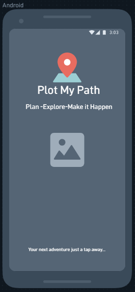
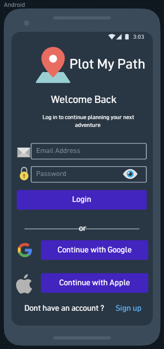
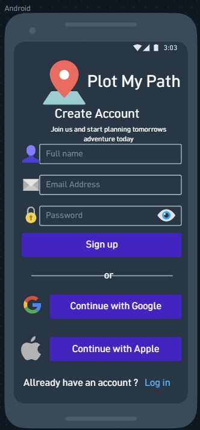
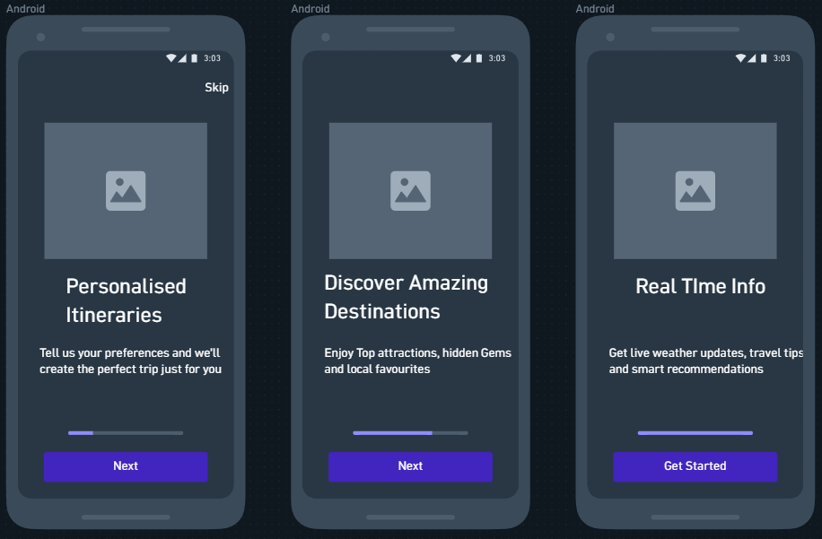
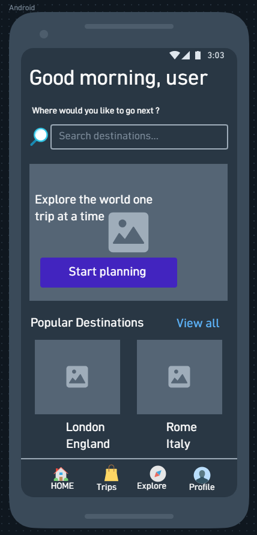
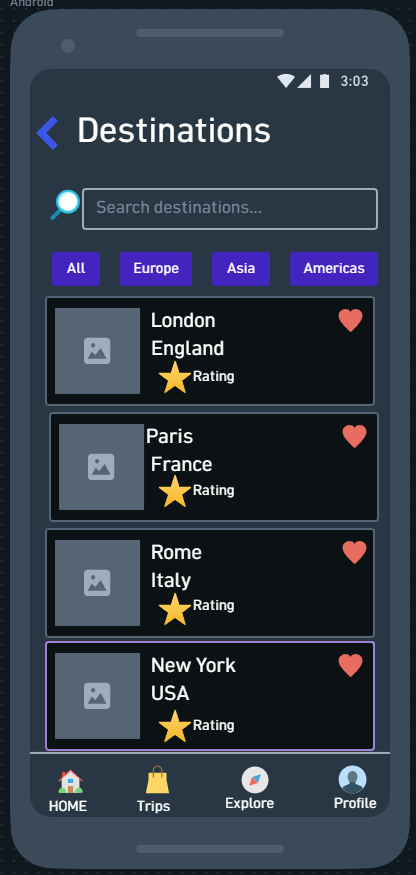
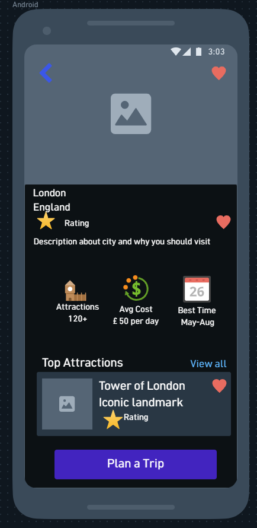
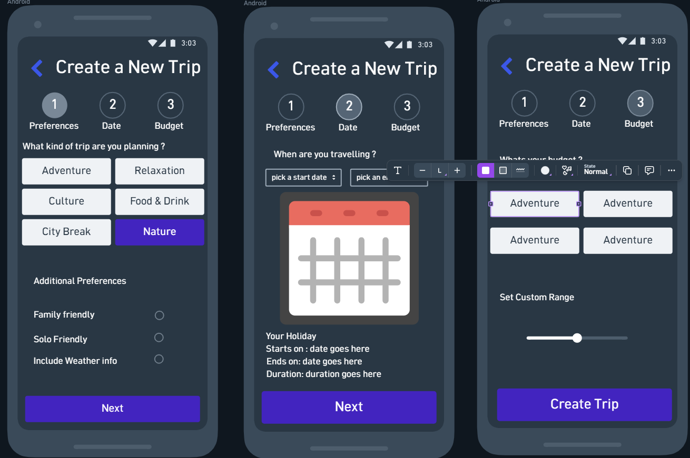
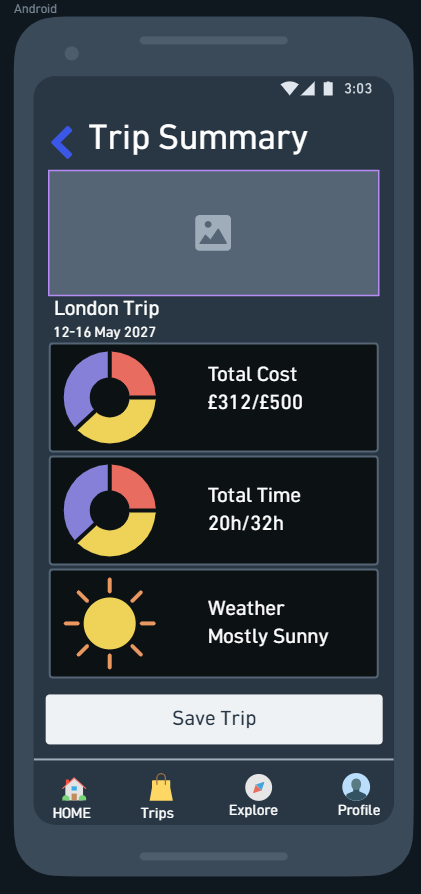
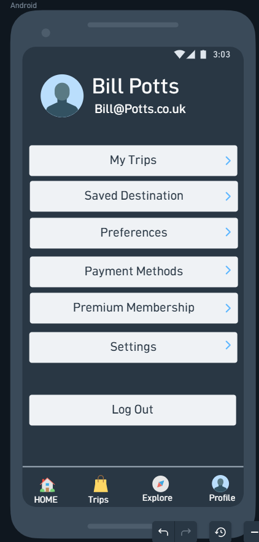

# Plot My Path
---

[To view site]
[To view backend]
 
## Table of Contents

## [UX](#ux-1)

- [Primary Goals](#primary-goals) 

- [Business Goals](#business-goals)

- [User Goals](#user-goals) 
- [User Stories](#user-stories)
- [Design Choices](#design-choices) 
- [ERD Diagram](#erd-diagram) 
- [Database Architecture](#database-architecture)
- [Wireframes](#wireframes) 

## [Features](#features-1)

- [Existing features](#existing-features) 
- [User Goals mapping](#user-goals-mapping) 
- [Features left to implement](#features-left-to-implement) 
- [User Goals still to implement](#user-goals-still-to-implement) 

## [Technologies used](#technologies-used-1)

## [Testing](#testing-1)

- [Lighthouse tests](#lighthouse-tests) 
- [HTML tests](#html-tests) 
- [CSS tests](#css-tests) 
- [Python code validation](#python-code-validation)
- [JSX Testing](#jsx-testing)
- [API Testing](#api-testing) 
- [Security](#security) 
- [Automated Testing](#automated-testing) 
- [Contrast tests](#contrast-tests) 
- [Keyboard Accessibility tests](#keyboard-accessibility-tests) 
- [Manual Features and Usability Testing Log](#manual-features-and-usability-testing-log) 
- [Development bugs and fixes](#development-bugs-and-fixes) 
- [Cross browser testing](#cross-browser-testing) 
- [User Testing](#user-testing) 

## [Deployment](#deployment-1) 

- [How to run this project](#how-to-run-this-project) 

## [Credits](#credits-1) 

- [Content/Media/Code/Acknowledgements](#contentmediacodeacknowledgements) 
- [dependencies](#dependencies) 

### UX
---
#### Primary Goals
--- 

THe primary goals are:
- To provide an application that helps users build a fun and immersive itinery for their holiday.
- To make planning your holiday as much fun as the holiday. 
- To show users new experiences and new Holiday destinations. 

[back to top](#plot-my-path)
#### Business Goals
---

The business goals are : 

The business goals are 
[back to top](#plot-my-path)
#### User Goals
---
[back to top](#plot-my-path)
#### User Stories
---
- For full acceptance criteria please see the project board [here](https://github.com/users/devildex91/projects/10)

- As a visitor, I want to browse and search for destinations and attractions, so that I can explore places that I may want to visit.
- As a registered user, I want to create and manage my own trips, so that I can plan and save my travel arrangements.
- As a registered user, I want to specify my interests and travel preferences, so that the application can help me create a trip that suits me.
- As a traveler, I want to build and organise an itinerary for my trip, so that I can plan what I will do each day.
- As a traveler, I want the application to generate itinerary recommendations based on my preferences, so that I can spend less time manually researching and organizing my trip.
- As a traveler, I want the application to identify problems with my itinerary, so that I can create a realistic travel plan.
- As a registered user, I want to securely access my account and manage my premium features, so that my trips and personal information are protected.
- As a traveler, I want to purchase premium functionality securely, so that I can access additional travel-planning features.


[back to top](#plot-my-path)
#### Design Choices
---
Plot My Path is designed as a mobile-first personal travel planning application. The interface is intended to help users discover destinations, create trips, organise activities and make decisions while travelling.

The design uses a clean, modern visual style with rounded cards, generous spacing, clear typography, imagery and a purple/blue primary colour scheme. These choices are intended to make the application feel approachable and easy to navigate while allowing travel information to remain the main focus.

The interface progressively adapts to larger screens rather than creating separate experiences for mobile, tablet and desktop. On smaller screens, information is prioritised and presented sequentially. On larger screens, related information can be displayed simultaneously, making better use of the available space.

This is particularly appropriate for a travel application because users may access the application in different contexts: planning at home on a desktop computer, researching destinations on a tablet, or checking an itinerary while travelling using a mobile phone.

[back to top](#plot-my-path)
#### ERD Diagram
---
[back to top](#plot-my-path)
#### Database Architecture
---
[back to top](#plot-my-path)
#### Wireframes 
---
Mobile Wireframes 
---
- Landing page
-  
- Login page
- 
- Register page
- 
- onboarding pages
- 
- Home page
- 
- Explore destination page
- 
- Destination detail page
- 
- Create plan page
- 
- Trip summary page
- 
- Profile page
- 

Tablet Wireframes
--- 
- Note: For landing page, login/register and onboarding pages please see mobile wireframes as the view on tablet will be identical but on a larger scale. 
- Homepage
- ![]
Desktop Wireframes
--- 
- Note:For landing page, login/register and onboarding pages please see mobile wireframes as the view on desktop will be identical but on a larger scale.  
[back to top](#plot-my-path)
### Features
---
Plot My Paths features will include:
- Public Homepage that will display all the relevent information to help the user immediately understand what the application does, who it is for and how it can help, what features are free and what will require a premium membership. 
- Destination explorer where users can browse destiantions while being told about useful information about each destination to help then decide where to go. 
- Each destination will then havbe an attraction explorer detailing a category it comes under, estimated visiting time, cost and accessibility for the user. 
- User Dashboard to make the app feel personal to the user while giving them a reason to log in and potential pay for the premium features on offer. 
- Trip creation so users can enter trip name, destination, start date and end date, budget, and avaliable hours per day.
- Trip preferences so that the app can become personalised to the user so they can enter hobbies and interests, budget and other useful information for the premium auto itinerary builder
- Manual itinierary builder avaliable to everyone so that then can add attractions change orders and plan their days accordingly.
- Map view so the users can see their destinations on the map.
- Premium feature: Personalised itenerary builder. 

                    

#### Existing features
---
[back to top](#plot-my-path)
#### User Goals mapping
---
[back to top](#plot-my-path)
#### Features left to implement
---
[back to top](#plot-my-path)
#### User Goals still to implement
---
[back to top](#plot-my-path)
### Technologies used
---
[back to top](#plot-my-path)
### Testing
---

#### Lighthouse tests 
---
[back to top](#plot-my-path)
#### HTML tests 
---
[back to top](#plot-my-path)
#### CSS tests 
---
[back to top](#plot-my-path)
#### Python code validation
---
[back to top](#plot-my-path)
#### JSX Testing
---
[back to top](#plot-my-path)
#### API Testing 
---
[back to top](#plot-my-path)
#### Security 
---
[back to top](#plot-my-path)
#### Automated Testing
---
[back to top](#plot-my-path)
#### Contrast tests 
---
[back to top](#plot-my-path)
#### Keyboard Accessibility tests 
---
[back to top](#plot-my-path)
#### Manual Features and Usability Testing Log
---
[back to top](#plot-my-path)
#### Development bugs and fixes
---
[back to top](#plot-my-path)
#### Cross browser testing
---
[back to top](#plot-my-path)
#### User Testing 
---
[back to top](#plot-my-path)
### Deployment
---
[back to top](#plot-my-path)
#### How to run this project 
---
[back to top](#plot-my-path)
### Credits
---

[back to top](#plot-my-path)
#### Content/Media/Code/Acknowledgements 
---
[back to top](#plot-my-path)
#### dependencies 
---
[back to top](#plot-my-path)

chat gpt used to help find right ids and fields to style for wizard forms and login/signup forms

orginally set up email backend with smtp but when deploying on render found out that it blocks the smtp on the hots server I was using so downloaded django anymail and set it up with brevo api key instead to get around this. 

Initially css loaded with   which although worked locally the css was being loaded as a js file and failing in live deployment so replaced with :
<link rel="stylesheet" href="" /> which fixed the issue 
plot-my-path
├─ accounts
│  ├─ admin.py
│  ├─ apps.py
│  ├─ migrations
│  │  ├─ 0001_initial.py
│  │  ├─ 0002_alter_travelpreference_budget_level_and_more.py
│  │  ├─ 0003_remove_weather_data.py
│  │  └─ __init__.py
│  ├─ models.py
│  ├─ tests.py
│  ├─ urls.py
│  ├─ views.py
│  └─ __init__.py
├─ assets
│  ├─ components
│  │  ├─ ActivityList.jsx
│  │  ├─ AddActivityForm.jsx
│  │  ├─ ItineraryMap.jsx
│  │  ├─ itinerary_builder.jsx
│  │  ├─ onboarding.jsx
│  │  ├─ searchBar.jsx
│  │  ├─ utils.js
│  │  └─ WeatherPanel.jsx
│  ├─ js
│  ├─ main.jsx
│  └─ styles
│     └─ style.css
├─ config
│  ├─ asgi.py
│  ├─ settings.py
│  ├─ urls.py
│  ├─ wsgi.py
│  └─ __init__.py
├─ core
│  ├─ admin.py
│  ├─ apps.py
│  ├─ forms.py
│  ├─ migrations
│  │  └─ __init__.py
│  ├─ models.py
│  ├─ tests.py
│  ├─ urls.py
│  ├─ views.py
│  └─ __init__.py
├─ destinations
│  ├─ admin.py
│  ├─ apps.py
│  ├─ fixtures
│  │  ├─ attractions
│  │  │  ├─ bangkok.json
│  │  │  ├─ barcelona.json
│  │  │  ├─ busan.json
│  │  │  ├─ cancun.json
│  │  │  ├─ chiang-mai.json
│  │  │  ├─ edinburugh.json
│  │  │  ├─ florence.json
│  │  │  ├─ kyoto.json
│  │  │  ├─ london.json
│  │  │  ├─ los-angeles.json
│  │  │  ├─ madrid.json
│  │  │  ├─ mexico-city.json
│  │  │  ├─ mumbai.json
│  │  │  ├─ new-delhi.json
│  │  │  ├─ new-york-city.json
│  │  │  ├─ nice.json
│  │  │  ├─ paris.json
│  │  │  ├─ rome.json
│  │  │  ├─ seoul.json
│  │  │  ├─ sydney.json
│  │  │  ├─ tokyo.json
│  │  │  ├─ toronto.json
│  │  │  └─ vancouver.json
│  │  ├─ initial_countries.json
│  │  └─ sample_destinations.json
│  ├─ migrations
│  │  ├─ 0001_initial.py
│  │  ├─ 0002_remove_attraction_image_url_and_more.py
│  │  └─ __init__.py
│  ├─ models.py
│  ├─ tests.py
│  ├─ urls.py
│  ├─ views.py
│  └─ __init__.py
├─ manage.py
├─ package-lock.json
├─ package.json
├─ payments
│  ├─ admin.py
│  ├─ apps.py
│  ├─ migrations
│  │  ├─ 0001_initial.py
│  │  ├─ 0002_alter_premiummembership_stripe_customer_id.py
│  │  └─ __init__.py
│  ├─ models.py
│  ├─ tests.py
│  ├─ urls.py
│  ├─ views.py
│  └─ __init__.py
├─ planner
│  ├─ admin.py
│  ├─ apps.py
│  ├─ migrations
│  │  ├─ 0001_initial.py
│  │  └─ __init__.py
│  ├─ models.py
│  ├─ tests.py
│  ├─ views.py
│  └─ __init__.py
├─ README.md
├─ requirements.txt
├─ static
│  ├─ assets
│  │  ├─ maplibre-gl-DudBHU-O-Ca6Bsq9c.js
│  │  ├─ maplibre-gl-worker-DeF4u0kt.js
│  │  ├─ rolldown-runtime-BrVfq_k5.js
│  │  └─ rolldown-runtime-D2aABDIb.js
│  ├─ css
│  │  └─ style.css
│  ├─ images
│  │  ├─ destination-img
│  │  ├─ home_img.avif
│  │  ├─ landing_background.avif
│  │  ├─ new_discovery.avif
│  │  ├─ personalised_itinery.avif
│  │  ├─ pmp-logo.png
│  │  ├─ readme-img
│  │  │  ├─ mobile-create-plan copy.png
│  │  │  ├─ mobile-create-plan.png
│  │  │  ├─ mobile-destination-detail.png
│  │  │  ├─ mobile-explore-destination.png
│  │  │  ├─ mobile-homepage.png
│  │  │  ├─ mobile-itinerary-builder.png
│  │  │  ├─ mobile-landing-page.png
│  │  │  ├─ mobile-login-page.png
│  │  │  ├─ mobile-onboarding-pages.png
│  │  │  ├─ mobile-profile.png
│  │  │  ├─ mobile-register-page.png
│  │  │  └─ mobile-trip-summary.png
│  │  └─ real_time.avif
│  ├─ js
│  │  ├─ app-bundle.js
│  │  └─ index-bundle.js
│  ├─ manifest.json
│  └─ maplibre
│     ├─ maplibre-gl-shared.mjs
│     └─ maplibre-gl-worker.mjs
├─ templates
│  ├─ account
│  │  ├─ login.html
│  │  └─ signup.html
│  ├─ accounts
│  │  ├─ favourite_destinations.html
│  │  └─ profile_page.html
│  ├─ allauth
│  │  └─ layouts
│  │     └─ base.html
│  ├─ base.html
│  ├─ core
│  │  ├─ contact.html
│  │  ├─ home.html
│  │  ├─ landing_page.html
│  │  └─ onboarding.html
│  ├─ destinations
│  │  ├─ destination.html
│  │  └─ destination_detail.html
│  ├─ payments
│  │  ├─ cancel.html
│  │  ├─ checkout.html
│  │  ├─ failed.html
│  │  └─ success.html
│  └─ trips
│     ├─ itinerary_builder.html
│     ├─ my_trips.html
│     └─ trips.html
├─ trips
│  ├─ admin.py
│  ├─ apps.py
│  ├─ forms.py
│  ├─ migrations
│  │  ├─ 0001_initial.py
│  │  └─ __init__.py
│  ├─ models.py
│  ├─ permissions.py
│  ├─ tests.py
│  ├─ urls.py
│  ├─ views.py
│  └─ __init__.py
└─ vite.config.mjs

```